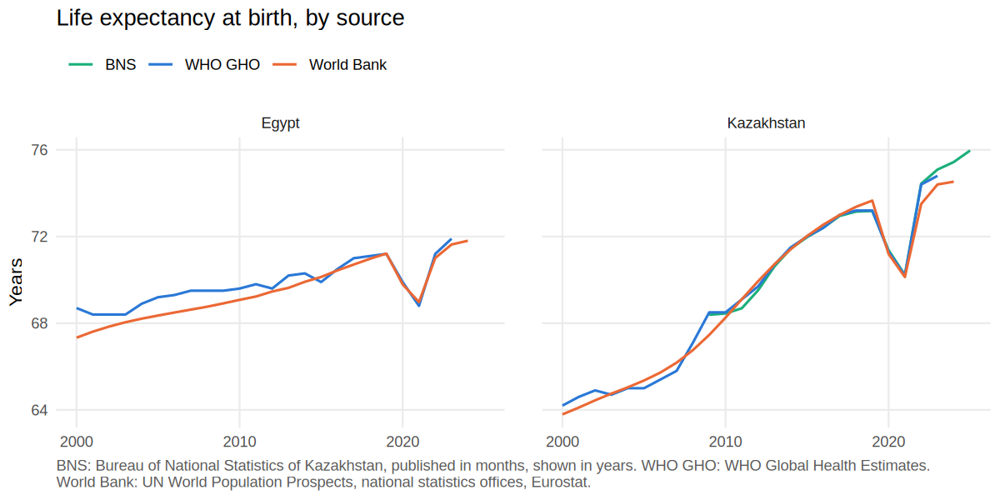

# Kazakhstan Public Health Data Pipeline

An R pipeline that pulls public health indicators for Kazakhstan every week from the Bureau of
National Statistics (BNS), the WHO Global Health Observatory and the World Bank, and checks
where they disagree. Egypt is included through the WHO and World Bank data.

I built it to answer two practical questions: do the national and international figures match,
and which source has the most recent data?

## Status

Each run rewrites [`reports/source_status.md`](reports/source_status.md). It lists the fetch
status of every source, when its data last changed, the latest year it covers and how far behind
it is, plus a table of cross-source differences. I don't type numbers into this README; they all
come from that report.



## Known issues and limitations

- Most World Bank health series are republished WHO or UN estimates (TB, DTP3, health
  expenditure, hospital beds, doctors, and infant, under-five and neonatal mortality). When WHO
  and the World Bank agree on these, that is expected and confirms nothing. Life expectancy is
  the exception: the World Bank uses UN World Population Prospects and national data, while WHO
  uses its own Global Health Estimates.
- DTP3 coverage for Kazakhstan depends on which source you look at, and part of the reason is
  that BNS itself has two different numbers. The administrative figure, which comes from the
  Ministry of Health's sanitary and epidemiological committee, is 98% for 2024. The MICS 2024
  household survey, also published by BNS, found 56.3% of children aged 24-35 months had their
  third dose. The World Bank shows 98%, the same as the administrative figure, which is odd
  because the World Bank says its DPT series comes from WHO/UNICEF. WHO/UNICEF shows 54%, close
  to the survey. My guess is that WHO/UNICEF trusted the survey over the administrative
  reports, but I haven't checked WHO's country notes for Kazakhstan, so I can't confirm it. The
  age groups also differ: WHO counts 1-year-olds, the World Bank 12-23 months and MICS 24-35
  months. More detail in [`docs/SOURCES.md`](docs/SOURCES.md).
- BNS calculates infant and neonatal mortality from registered births and deaths. WHO and the
  World Bank use UN IGME model estimates. The two have drifted apart in recent years, which
  reflects different methods rather than an error in either.
- BNS publishes life expectancy in months. The pipeline converts it to years with a factor of
  `1/12`.
- BNS reports TB incidence (SDG 3.3.2) from Ministry of Health administrative data, and WHO
  publishes a modelled estimate. Their values differ, so I store them as separate indicators and
  never compare them. The BNS file also contains some impossible values in its 2019 regional
  rows, so only the national total is used.
- World Bank hospital beds and physicians are given per 1,000 people and are converted to per
  10,000 in `R/tidy.R`. Every unit conversion is written in `sources.csv`.
- WHO has said it will replace the current GHO OData API. It still worked on 2026-10-19. If it
  stops working, the run will report the WHO sources as failed.
- The two AMR indicators cover Egypt only and come from a single source, so they are not part of
  the Kazakhstan comparison. See [Host-country context](#host-country-context-egypt-who-glass).
- All data is national level. Egypt only has the international sources.

## Sources

| Publisher | Access | Indicators | Status |
|---|---|---|---|
| Bureau of National Statistics (KZ) | Taldau JSON API + XLSX downloads | 8 | automated |
| WHO Global Health Observatory | OData JSON API | 9 (+2 Egypt context) | automated |
| World Bank WDI | JSON API | 9 | automated |

Indicators covered: life expectancy, infant, under-five and neonatal mortality, TB incidence,
DTP3 coverage, hospital beds, doctors and current health expenditure.

[`docs/SOURCES.md`](docs/SOURCES.md) documents each source in full, including update frequency,
access method, licence and known issues.

## Host-country context: Egypt (WHO GLASS)

The repo also tracks two antimicrobial resistance (AMR) indicators from WHO GLASS, published in
the GHO under SDG 3.d.2: the share of bloodstream infections caused by MRSA, and the share caused
by *E. coli* resistant to third-generation cephalosporins. These are separate from the Kazakhstan
comparison, for three reasons:

- The GHO has no AMR data for Kazakhstan, and the status report shows this as "no data KAZ".
  Kazakhstan does report AMR data to WHO Europe's CAESAR network (confirmed for 2023 data). I
  could not confirm whether it also reports to GLASS.
- Only one source publishes these indicators, so there is nothing to cross-check them against.
- Egypt's figures are shares of tested bloodstream samples, not resistance rates for the whole
  population. They jump around from year to year because the sample counts are small, and those
  counts are not published.

I kept them because they show the source list working across countries as well as sources.
Adding them took two rows in `sources.csv` with `KAZ;EGY` and no new code, and the pipeline
handled Kazakhstan's missing data without any special case.

Isolate-level AMR analysis with the `AMR` R package is in a separate repository,
[`amr-surveillance-r`](https://github.com/FerrumSL/amr-surveillance-r).

## How it works

```
sources.csv -> fetch -> schema check -> hash check -> data/raw/<source_id>/<date>/
            -> R/tidy.R -> data/processed/indicators.csv
            -> R/check_consistency.R -> R/report.R -> reports/source_status.md
```

Every source is defined in [`sources.csv`](sources.csv): the indicator, its code, the countries,
the URL template, units and any unit conversion, and for spreadsheets the sheet and row to read.
`R/run_all.R` sends each row to the right fetcher and parser based on its `publisher` and
`access_method`. Adding another indicator from an existing publisher means adding one row, and
adding a country means adding one code to `countries`.

Each download is hashed with SHA-256. If the hash matches the latest saved copy, the run logs
`unchanged` and saves nothing. If it differs, the file is saved as a new dated snapshot and
logged as `updated`. Raw snapshots are never edited by hand.

Before saving anything, each parser checks that the response still has the shape it expects:
the fields it reads (or the sheet, row label and unit for spreadsheets), no paging, exactly one
value per country and year, and only the countries that were requested. If any of that fails,
the run logs `schema_changed` and doesn't store the file. It still writes the log and the report,
then exits with an error so the problem is visible.

[`data/run_log.csv`](data/run_log.csv) gets one row per source per run, with the columns
`run_at, source_id, status, rows, hash, message`.

For each indicator and country with more than one source, the pipeline compares the latest year
they have in common. The relative difference is |a - b| / mean(a, b), and anything above 5% is
flagged. A flag only means the sources disagree; it doesn't say which one is right.

[`tests/testthat/test_schema.R`](tests/testthat/test_schema.R) gives each parser a saved real
response, then the same response with a field, sheet, label or unit changed, and checks that the
parser reports `schema_changed` instead of returning data.

GitHub Actions runs the tests and the pipeline every Monday at 06:00 UTC and commits any changes
in `data/` and `reports/`, so the commit history doubles as the update history.

## Reproducing

You need R (I used 4.6.1) and an internet connection.

```r
renv::restore()
```

```sh
Rscript R/run_all.R
Rscript -e 'testthat::test_dir("tests/testthat")'
```

## Repository layout

```
sources.csv                       source list (every source is defined here)
R/run_all.R                       entry point
R/fetch_bns.R, R/fetch_gho.R,
R/fetch_worldbank.R               fetch and parse functions for each publisher
R/utils.R                         download, hashing, snapshots, run log
R/tidy.R                          raw -> data/processed/indicators.csv
R/check_consistency.R             cross-source comparison
R/report.R                        reports/source_status.md and figure
data/raw/<source_id>/<date>/      raw snapshots, committed, never edited
data/processed/indicators.csv     tidy panel: country, indicator, year, value, unit, source_id,
                                  publisher, snapshot_date
data/run_log.csv                  one row per source per run
docs/SOURCES.md                   source documentation
tests/testthat/                   schema tests and saved fixtures
```

## Data licences and attribution

The code is under the MIT licence (see [`LICENSE`](LICENSE)). The MIT licence does not cover
the data. The raw files in `data/raw/` are shared under each publisher's terms:

- BNS: Bureau of National Statistics of the Agency for Strategic Planning and Reforms of the
  Republic of Kazakhstan, <https://stat.gov.kz/>. Free to reuse for any purpose, as long as the
  source is credited.
- WHO: WHO, Global Health Observatory, accessed on the dates in `data/run_log.csv`. Used under
  WHO's terms for data compilations, which allow use for public health purposes with
  attribution and rule out selling the data or using it for commercial promotion.
- World Bank: World Development Indicators, The World Bank, CC BY 4.0.

## Not included

I left these out on purpose for this version: data from CAPMAS (Egypt's statistics agency),
regional (oblast-level) data, a dashboard, forecasting and a database server.
